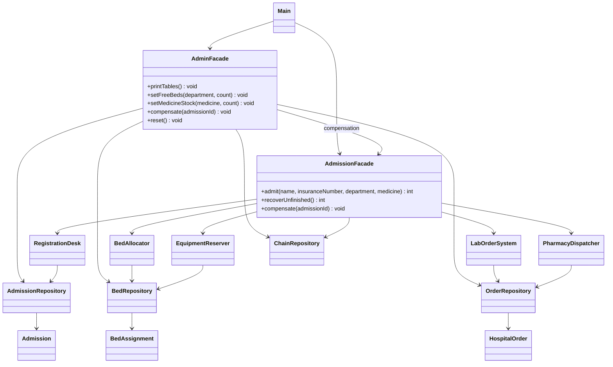
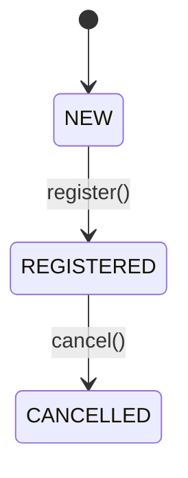
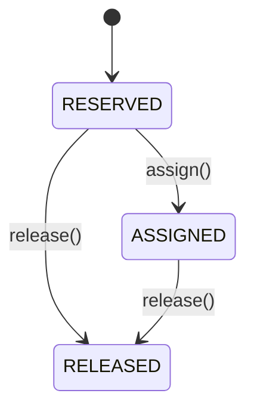
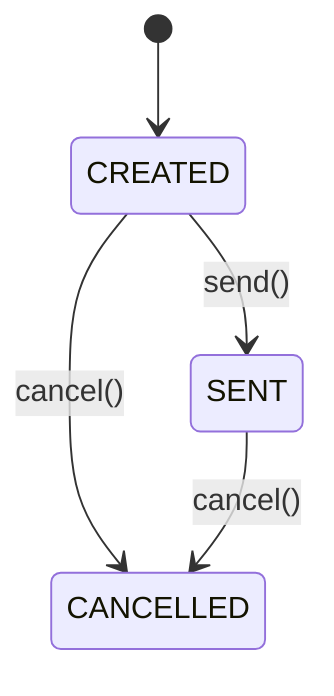
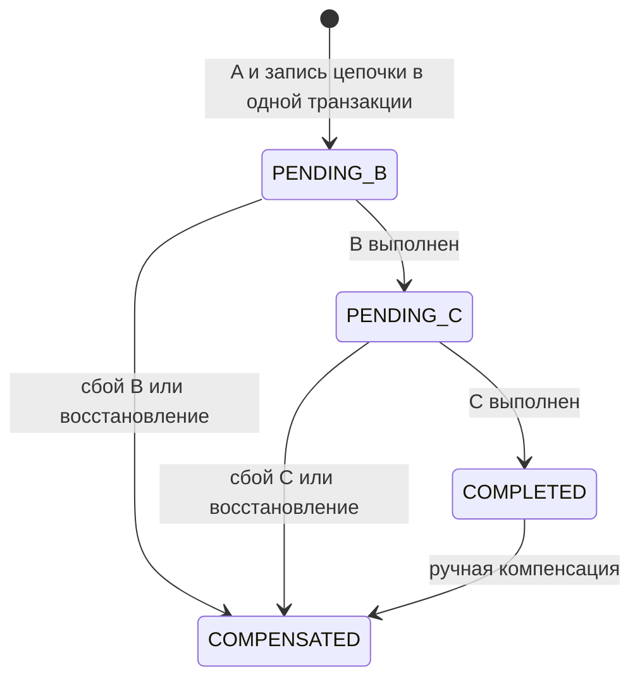
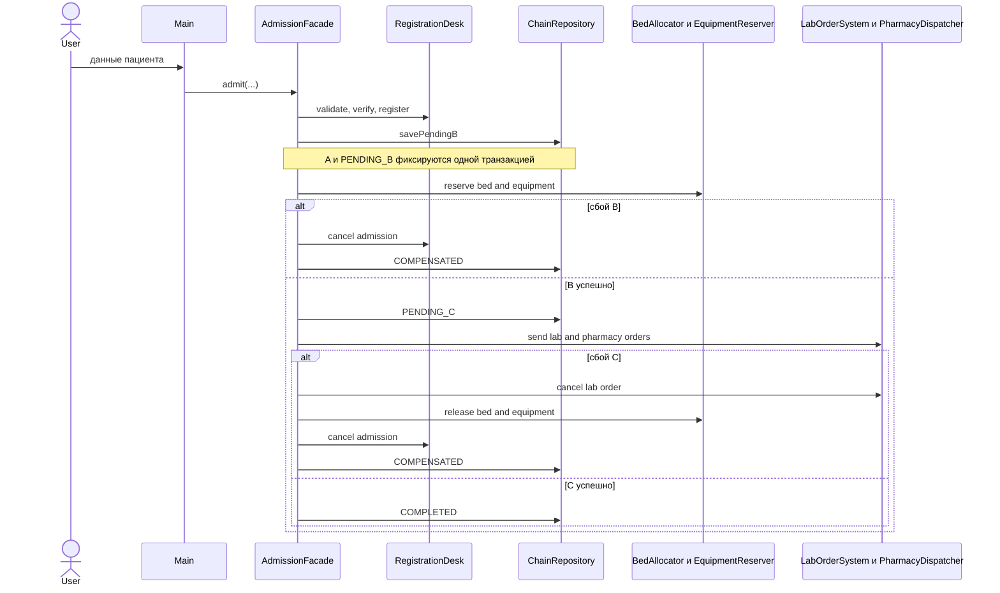

# UML: Hospital Admission

## Классы и зависимости

Подсистемы `registration`, `bed` и `orders` не зависят друг от друга. Их координация находится в `facade`.

## Состояния сущностей и цепочки

## Последовательность приёма

